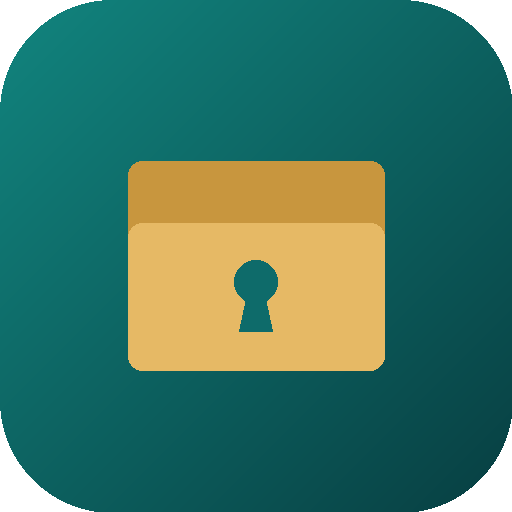

# ملفات المساوى PRO — Al-Masawa Files PRO

> «كل ملفاتك... تحت سيطرتك»

مدير ملفات احترافي لأندرويد مبني بـ Kotlin وJetpack Compose وMaterial 3، بواجهة عربية RTL كاملة وإنجليزية.



## حالة المشروع

| المرحلة | المحتوى | الحالة |
|---|---|---|
| 1 | الهيكل، الثيم، الشاشة الرئيسية، لوحات الوصول السريع، تصفح الملفات المحلية | مكتملة |
| 2 | نسخ/نقل/لصق مع التقدم، تبويبات، بحث، مدير مزدوج اختياري، ضغط ZIP، عارض الصور، محرر النصوص | **هذه النسخة (0.2.0)** |
| 3 | مدير التطبيقات، محلل التخزين وخريطة Treemap، التنظيف الذكي، سلة المحذوفات | قادمة |
| 4 | الخزنة المشفرة، المساعد الذكي، أدوات الخبراء | قادمة |
| 5 | USB/SD، الشبكات، السحابة، النقل عبر Wi-Fi، المزامنة | قادمة |
| 6 | الأداء، اختبارات الأمان والواجهة، الإصدار النهائي | قادمة |

## مزايا المرحلة 2

- **نسخ ونقل ولصق** بين أي مجلدين، مع شريط تقدم وسرعة ووقت متبقٍّ وزر إلغاء.
- **معالجة تعارض الأسماء:** استبدال، أو الاحتفاظ بالاثنين (إعادة تسمية تلقائية)، أو تخطي. التخطي في النقل لا يحذف الملف المصدر.
- **حماية:** فحص المساحة قبل النسخ، ومنع نسخ المجلد إلى داخل نفسه، وعدم حذف المصدر عند النسخ فوق نفسه.
- **تبويبات متعددة** تُحفظ وتُستعاد بعد إعادة التشغيل.
- **بحث** بالاسم داخل المجلد الحالي وما تحته، مع فلاتر (صور، فيديو، موسيقى، PDF، Word، Excel، APK، أرشيفات، كبيرة، حديثة، قديمة) وسجل بحث. يعمل في الخلفية دون تجميد الواجهة ويمكن إيقافه.
- **المدير المزدوج (اختياري):** من الإعدادات ← «وضع العرض المتقدم». الحالة الافتراضية **معطّل**. عند التفعيل يظهر الزر في الرئيسية وشريط الأدوات، ويُحفظ آخر مساري اللوحتين. عند التعطيل يختفي الزر وتبقى البيانات.
- **ضغط ZIP واستخراجه** مع حماية من هجوم Zip-Slip.
- **مشاركة** الملفات، **خصائص** الملف، **نسخ المسار**، وحساب **MD5 / SHA-256**.
- **عارض الصور:** تكبير وسحب، تدوير، التنقل بين صور المجلد، مشاركة، ومعلومات EXIF (دون بيانات الموقع).
- **محرر النصوص:** تعديل وحفظ ملفات txt/md/json/csv/xml/html وغيرها حتى 2 ميغابايت، مع بحث داخل النص وتنسيق JSON.

## حدود معروفة (بصراحة)

- الأرشيفات في هذه المرحلة: **ZIP فقط** (إنشاء واستخراج). 7Z وTAR وRAR وكلمات المرور تحتاج مكتبات إضافية وتأتي لاحقاً. RAR للاستخراج فقط.
- الفيديو والصوت وPDF تُفتح حالياً بتطبيقات النظام. المشغّل الداخلي مؤجَّل لمرحلة لاحقة.
- الإيقاف المؤقت والاستئناف للعمليات غير متاح بعد (الإلغاء متاح).
- الحذف **نهائي** حتى تصل سلة المحذوفات في المرحلة 3.
- ترتيب اللوحات بالسحب والإفلات لم يُنفَّذ بعد.
- الوصول إلى `Android/data` و`Android/obb` غير مضمون على كل الأجهزة ويُستثنى من البحث.

## البناء

الطريقة الموصى بها: ارفع المشروع إلى GitHub على الفرع `main`، فيعمل Workflow باسم **Android CI** تلقائياً:

1. يشغّل اختبارات الوحدة.
2. يبني نسخة Debug APK.
3. يتحقق من وجود ملف APK.
4. يرفع الـAPK وتقارير الاختبارات كـ Artifacts (من تبويب Actions ← آخر تشغيل ← Artifacts).

لا يوجد Gradle wrapper في المستودع؛ الـWorkflow يثبّت Gradle 8.9 بنفسه. للبناء محلياً: JDK 17 وAndroid SDK 35 ثم `gradle assembleDebug`.

### توقيع نسخة Release (لاحقاً)

عيّن متغيرات البيئة `KEYSTORE_PATH` و`KEYSTORE_PASSWORD` و`KEY_ALIAS` و`KEY_PASSWORD` ثم `gradle assembleRelease`.

## الصلاحيات

- `MANAGE_EXTERNAL_STORAGE` (الوصول لكل الملفات): مناسبة للتوزيع المباشر عبر APK، وقد ترفضها سياسات Google Play.
- على أندرويد 10 يُطلب إذن القراءة والكتابة العادي.
- لا يُرسل التطبيق أي بيانات خارج الجهاز.

## بنية المشروع

```
app/src/main/java/com/almasawa/files/
├── data/
│   ├── db/            Room: اللوحات وعناصرها
│   ├── files/         FileRepository، FileOps (نسخ/نقل/ZIP)، TaskManager، PaneModel، البحث
│   └── settings/      DataStore: الثيم، الفرز، التبويبات، المدير المزدوج، سجل البحث
├── di/                Hilt
├── ui/                home، browser، dual، search، panels، settings، viewer، components، nav
└── util/              الصلاحيات، المشاركة، أنواع العارضات
```

## الاختبارات

اختبارات وحدة تعمل على JVM (`gradle testDebugUnitTest`) وتغطي: الفرز، التحقق من الأسماء، النسخ والنقل بكل سياسات التعارض، الإلغاء، منع النسخ إلى الذات، ضغط/استخراج ZIP، رفض Zip-Slip، وبصمات MD5/SHA-256.
اختبارات الواجهة وAndroid Instrumented تأتي في المرحلة 6.

## الأيقونة

مجلد ذهبي بثقب مفتاح على خلفية تركوازية متدرجة (تعبيراً عن «تحت سيطرتك»). أيقونة تكيفية مع طبقة أحادية اللون لدعم Themed Icons في أندرويد 13+. نسخة 512 بكسل في `docs/icon-512.png`.
